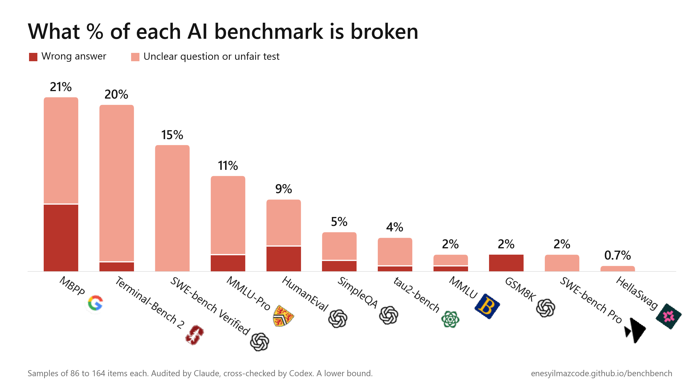

# benchbench

A benchmark for benchmarks. It audits the questions, answer keys and tests of popular AI benchmarks and measures how many of them are broken.

Benchmark scores get quoted to a tenth of a point. If 10% of a benchmark's answer keys are wrong, that tenth means nothing. benchbench takes a random sample of each benchmark, has two Claude models solve and review every item without seeing each other's work, runs the code where there is code, and asks a model from another lab to check every flag.



Dark red is a provably wrong answer key. Light red is everything else that counts as broken: an ambiguous or unanswerable question, or a test that rejects a reasonable answer. Those are judgment calls by the reviewers, each with its reasoning on the report page. The chart leaves out MATH-500, AIME 2025 and HMMT 2025 because nothing in them was found broken; they are in the table below.

## Results

| Benchmark | Audited | Broken | Rate | 95% CI | Weak tests |
|---|---:|---:|---:|---|---:|
| MBPP (sanitized) | 150 | 31 | 20.7% | 15.0% to 27.8% | 52.0% |
| Terminal-Bench 2.0 | 86 | 17 | 19.8% | 12.7% to 29.4% | 22.1% |
| SWE-bench Verified | 100 | 15 | 15.0% | 9.3% to 23.3% |  |
| MMLU-Pro | 150 | 17 | 11.3% | 7.2% to 17.4% |  |
| HumanEval | 164 | 14 | 8.5% | 5.2% to 13.8% | 77.4% |
| SimpleQA | 150 | 7 | 4.7% | 2.3% to 9.3% |  |
| tau2-bench | 150 | 6 | 4.0% | 1.8% to 8.5% |  |
| MMLU | 150 | 3 | 2.0% | 0.7% to 5.7% |  |
| GSM8K | 150 | 3 | 2.0% | 0.7% to 5.7% |  |
| SWE-bench Pro | 100 | 2 | 2.0% | 0.6% to 7.0% | 1.0% |
| HellaSwag | 150 | 1 | 0.7% | 0.1% to 3.7% |  |
| MATH-500 | 150 | 0 | 0.0% | 0.0% to 2.5% |  |
| AIME 2025 | 30 | 0 | 0.0% | 0.0% to 11.4% |  |
| HMMT February 2025 | 30 | 0 | 0.0% | 0.0% to 11.4% |  |

Why the sample sizes differ:

- **150 items** for most benchmarks, picked at random. That keeps the 95% range to a few points on either side and the run to a night on a subscription.
- **100 for SWE-bench Verified and SWE-bench Pro**, because each task means reading a real code repository, its issue, the fix and its tests, which takes many times longer than a question.
- **Every item** of the small benchmarks: all 30 of AIME and HMMT, all 164 of HumanEval, and Terminal-Bench, which has 89.
- Different sizes are fine: each row's 95% range already reflects its own sample size.

A benchmark joins the table only when every sampled item is audited. The one exception is named in the code: three Terminal-Bench tasks (query-optimize, regex-chess, rstan-to-pystan) where the auditors tried to solve the task outright and ran past 40 minutes twice, so Terminal-Bench is 86 of 89.

What the columns mean:

- **Audited**: how many items from the benchmark we checked, picked at random. An item is one question or one task.
- **Broken**: how many of those items are wrong in a way that changes a model's score. That is one of four things: the official answer is wrong (wrong key), the question can reasonably be read more than one way (ambiguous), it cannot be answered from what it gives you (unanswerable), or the grader rejects a correct answer (grader flawed). An item counts only if both Claude reviewers agree, or a third judging call decides it after they split.
- **Rate**: Broken divided by Audited.
- **95% CI**: the range the true rate for the whole benchmark most likely falls in, given that we only checked a sample (a Wilson interval). Small samples give wide ranges, which is why AIME and HMMT show 0% but up to 11%.
- **Weak tests**: only for benchmarks graded by tests. The share of items whose tests pass a solution that is actually wrong. It is counted separately and is not part of Broken. For HumanEval and MBPP it is measured: each auditor writes a deliberately wrong solution plus one input that shows the bug, we run both against the official tests on Modal, and if the wrong solution passes the tests while giving a different answer from the reference on that input, the reviewers check that the input is one the task allows and the wrong answer breaks a stated requirement. For Terminal-Bench and SWE-bench Pro it is the reviewers' verdict after reading the tests.

MMLU is sampled from the 5,700 questions (100 from each of its 57 subjects) that MMLU-Redux later re-checked by hand, scored against MMLU's original answer keys.

The full report, with every finding and the reasons behind it, is at [enesyilmazcode.github.io/benchbench](https://enesyilmazcode.github.io/benchbench/) (source in `docs/index.html`). Every flagged item is in `results/findings.jsonl`.

## The benchmarks

| Benchmark | What it tests | Made by |
|---|---|---|
| MBPP (Mostly Basic Python Problems) | short Python functions, graded by tests | Google |
| Terminal-Bench 2.0 | multi-step tasks in a Linux terminal | Stanford and the Laude Institute |
| SWE-bench Verified | fixing real GitHub issues in Python projects, graded by the project's tests | OpenAI, from Princeton's SWE-bench |
| MMLU-Pro | harder 10-option version of MMLU | TIGER-Lab, University of Waterloo |
| HumanEval | Python functions from a docstring, graded by tests | OpenAI |
| SimpleQA | short factual questions with one answer | OpenAI |
| tau2-bench | customer-service agent tasks against a simulated user and real tools | Sierra |
| MMLU | multiple-choice exam questions in 57 subjects | UC Berkeley |
| GSM8K | grade-school math word problems | OpenAI |
| SWE-bench Pro | harder, longer real-repository coding tasks | Scale AI |
| HellaSwag | picking the sensible ending of a short scenario | University of Washington and AI2 |
| MATH-500 | competition math problems | OpenAI, from Berkeley's MATH |
| AIME 2025, HMMT February 2025 | this year's high-school math competition problems | MAA, HMMT |

## Examples

**GSM8K (Grade School Math 8K, OpenAI's grade-school word problems) 952.** "Vince can staple 30 reports every 15 minutes. If he was stapling reports from 8:00 AM until 11:00 PM, how many reports did he staple?" The key says 360, which is three hours. 8 AM to 11 PM is fifteen hours, so the answer is 1800.

**GSM8K 1309.** Kim raises $750, Alexandra $430, Maryam $700, Sarah $300. The key says 2280. The total is 2180; the key added Maryam's $400 difference in place of Sarah's $300.

**HumanEval (OpenAI's 164 Python coding problems, graded by unit tests) 97.** `multiply(a, b)` should return the product of the unit digits. The reference takes Python's modulo before `abs`, so `multiply(14, -12)` returns 32 instead of 8. The one negative test ends in 5, which hides the bug.

**MMLU (Massive Multitask Language Understanding, multiple-choice questions in 57 subjects) electrical engineering 17.** The feedback factor of a Wien bridge oscillator is 1/3. The key says 1/2.

## How it works

1. **Sample.** A fixed random sample per benchmark: 150 items, 100 for the SWE-bench sets, and every item of the small ones (AIME, HMMT, HumanEval, Terminal-Bench). Static checks also run on every item: duplicates, empty answers, keys that are not among the options.
2. **Solve blind.** Claude Opus and Claude Sonnet each answer the item without seeing the key, then review it with the key.
3. **Judge.** When the two disagree, Opus at its highest effort reads both reviews, checks their claims and decides. An item counts as broken only if both reviewers or the judge say so.
4. **Run the code.** For HumanEval and MBPP the official tests run on Modal against the reference, two independent solutions and two deliberately buggy ones.
5. **Read the tasks.** SWE-bench, Terminal-Bench and tau2 are reviewed with the real files in the auditor's folder: the issue, gold patch and tests; the task folder; or the domain policy, database and tool code.
6. **Cross-check.** Every broken verdict on a question or task also goes to Codex (GPT-5.6), which sees the evidence but not the verdicts. It voted on 114 of the 116 flags (it hit its usage limit on the last two): it agrees with 85, calls 9 correct, and is unsure on 20, all of them Terminal-Bench (15) or tau2 (5) tasks. Codex would not commit on any Terminal-Bench flag, so that row rests on the two Claude reviewers alone.

## Check the checker

The same pipeline ran on 120 MMLU-Redux items that humans have already labeled. It reaches 93% precision and 42% recall: when it says an item is broken it is almost always right, and it finds a bit under half of the broken items. Read the rates above as a lower bound.

## Run it

```
pip install -r requirements.txt
python -X utf8 -m bb.static              # checks on every item
python -X utf8 -m bb.audit gsm8k mmlu    # resumable, results in runs/results/
python -X utf8 -m bb.validate            # precision and recall against MMLU-Redux
python -X utf8 -m bb.crosscheck gsm8k    # Codex vote on every flag
python -X utf8 -m bb.report              # results/summary.json and findings.jsonl
python -X utf8 -m bb.site                # docs/index.html
```

The auditors are the Claude Code and Codex CLIs, so it runs on their logins. Code execution needs a Modal account. GPQA Diamond and Humanity's Last Exam are gated and their terms forbid publishing items, so they are not included.
